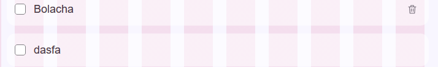

# Quicklist

Quicklist is a responsive shopping-list interface built with HTML, CSS and JavaScript.



## Features

- Add items through a text field and submit button
- Mark items as purchased with checkboxes
- Remove items with the trash button
- Show a removal notification
- Close the notification manually
- Use a responsive layout on desktop and mobile

## Project structure

```text
.
|-- index.html
|-- styles.css
|-- scripts.js
|-- assets/
|   |-- project-preview.png
|   `-- supporting image and icon files
`-- README.md
```

## How the code works

### HTML

`index.html` contains the complete page structure:

- `<header>` displays the Quicklist brand.
- `<form class="add-item">` contains the text input and submit button.
- `<ul class="shopping-list">` contains the default shopping items.
- Each `<li class="shopping-item">` contains a checkbox, label and remove button.
- `<aside class="notice">` displays a message after an item is removed.
- `scripts.js` is loaded at the end of the body so the HTML elements exist before JavaScript tries to find them.

### JavaScript

`scripts.js` is responsible for all user interactions.

#### Finding elements

The script obtains references to the form, input, list and notification using `document.querySelector` and `getElementById`.

#### Adding an item

When the form is submitted:

1. `event.preventDefault()` prevents the browser from refreshing the page.
2. `input.value.trim()` removes accidental spaces and obtains the item name.
3. The script returns immediately if the name is empty.
4. `document.createElement("li")` creates a new list item.
5. Separate elements are created for the label, checkbox and remove button.
6. `activateRemove(removeButton)` connects the remove behavior to the new button.
7. `list.appendChild(newItem)` inserts the item into the list.
8. `input.value = ""` clears the field for the next item.

#### Removing an item

The `activateRemove` function receives a remove button and listens for a click:

```js
button.closest(".shopping-item").remove();
```

`closest(".shopping-item")` starts at the clicked button and finds its parent `<li>`. The `remove()` method then removes the entire row.

The script also runs `activateRemove` for every remove button that already exists in the HTML. This gives both existing and newly created items the same behavior.

#### Showing the notification

The notification starts with `notice.hidden = true`, so it is hidden after a page reload or when the page opens.

Whenever an item is removed, `notice.hidden = false` makes the `<aside>` visible. The close button changes it back to `true`.

### CSS

`styles.css` controls the layout and visual appearance:

- `box-sizing: border-box` makes width and height calculations include padding and borders.
- Flexbox positions elements inside rows and the notification.
- The striped background is created with `repeating-linear-gradient`.
- CSS Grid arranges the shopping items vertically.
- `.notice[hidden]` is required because the base `.notice` rule uses `display: flex`.
- `@media (max-width: 520px)` changes the layout for mobile screens.

## Running the project

No build tools or dependencies are required.

1. Download or clone this repository.
2. Open `index.html` in a modern browser.
3. Enter an item and click **Adicionar item**.
4. Use the trash button to remove an item.
5. Use the close button to hide the notification.
